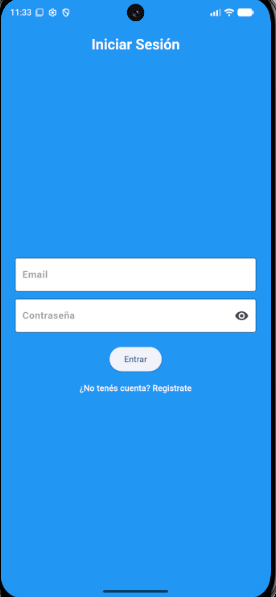
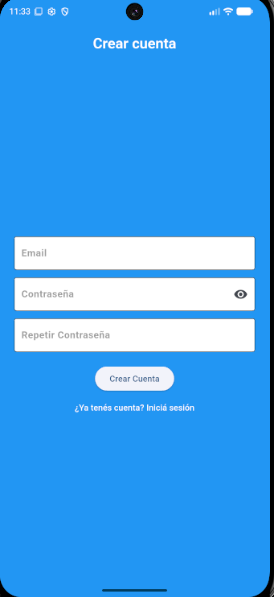
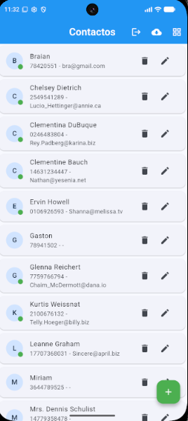
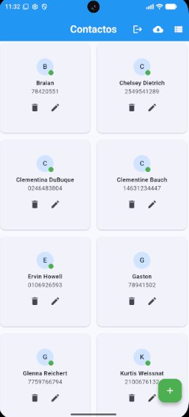
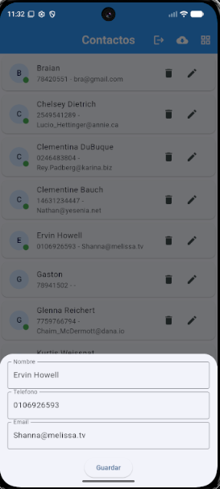

# Contactos App

App móvil de contactos hecha con **Flutter**, con registro e inicio de sesión, datos en tiempo real en **Firestore** y manejo de estado con **Riverpod**. Cada usuario ve y administra solo sus propios contactos.

Es un proyecto de práctica para consolidar Flutter y Firebase de punta a punta: interfaz, formularios, datos remotos, autenticación, seguridad y arquitectura.

## Capturas

| Iniciar sesión | Crear cuenta | Vista de lista | Vista de cuadrícula | Editar |
|:---:|:---:|:---:|:---:|:---:|
|  |  |  |  |  |

## Funcionalidades

- Registro e inicio de sesión con email y contraseña (Firebase Authentication). La sesión se recuerda al cerrar y abrir la app.
- Contactos separados por usuario, protegidos con reglas de seguridad de Firestore.
- Alta, edición y eliminación de contactos, con confirmación antes de borrar y opción de **deshacer**.
- Actualización en tiempo real: los cambios en la base se reflejan solos en pantalla.
- Formularios con validación (nombre obligatorio, teléfono solo con números, email con formato válido y teléfono no repetido).
- Vista de lista o de cuadrícula; en pantallas anchas se muestra la cuadrícula automáticamente.
- Tema claro y oscuro, según la configuración del dispositivo.
- Importación de contactos desde una API pública (JSONPlaceholder), sin duplicar los que ya existen.
- Manejo de estados de carga, error con botón de reintentar y lista vacía, además de avisos cuando falla una operación.

## Tecnologías

- **Flutter** y **Dart**
- **Firebase Authentication** y **Cloud Firestore**
- **Riverpod** (`Provider`, `StreamProvider`, `Notifier`)
- **http** para consumir la API externa

## Arquitectura

Cada capa tiene un solo trabajo:

```
lib/
├── models/       # Contacto: datos, toMap y constructores fromMap / fromApi / fromFirestore
├── services/     # Acceso a Firebase y a la API (repositorio de contactos, autenticación)
├── providers/    # Providers de Riverpod: repositorio, contactos en tiempo real, estado de la vista
├── screens/      # Pantallas: login, lista, detalle y AuthGate (decide qué pantalla mostrar)
├── widgets/      # Componentes reutilizables, como la tarjeta de contacto
└── utils/        # Validadores, diálogos, formulario y traducción de errores de Firebase
```

- `AuthGate` escucha el estado de la sesión y muestra el login o la lista, sin navegación manual.
- Los contactos se leen con un `StreamProvider` sobre `snapshots()` de Firestore, y la pantalla solo dibuja el resultado.
- Los datos de cada usuario viven en `usuarios/{uid}/contactos`.

## Cómo correrlo

Requisitos: Flutter instalado y un proyecto propio de Firebase. Por razones de seguridad, los archivos de configuración de Firebase no se incluyen en el repositorio.

1. Clonar e instalar dependencias:

   ```bash
   git clone https://github.com/GastonBartolucci05/contactos-app.git
   cd contactos-app
   flutter pub get
   ```

2. En la [consola de Firebase](https://console.firebase.google.com), crear un proyecto, activar **Authentication** (método Correo electrónico/contraseña) y crear una base **Firestore**.

3. Conectar la app con tu proyecto:

   ```bash
   dart pub global activate flutterfire_cli
   flutterfire configure
   ```

   Elegir tu proyecto y la plataforma **Android**. Esto genera `lib/firebase_options.dart`.

4. En Firestore, pestaña **Reglas**, publicar:

   ```
   rules_version = '2';
   service cloud.firestore {
     match /databases/{database}/documents {
       match /usuarios/{uid}/{document=**} {
         allow read, write: if request.auth != null && request.auth.uid == uid;
       }
     }
   }
   ```

5. Ejecutar:

   ```bash
   flutter run
   ```

Notas:

- La app está configurada solo para **Android**.
- Requiere `minSdk 24` (lo pide `cloud_firestore`).
- Si en el emulador queda la pantalla blanca con el logo de Flutter, probar con `flutter run --no-enable-impeller`.

## Qué practiqué con este proyecto

- Layouts adaptables, formularios con validación y temas claro y oscuro.
- Programación asíncrona en Dart: `Future`, `async/await`, `Stream`, `try/catch/finally` y tiempos de espera.
- Modelado de datos y conversión entre objetos, JSON y documentos de Firestore.
- Autenticación, reglas de seguridad y datos separados por usuario.
- Separación en capas (modelo, repositorio, provider, pantalla) y estado con Riverpod.

## Próximos pasos

- Pruebas automáticas de la lógica y de los providers.
- `AsyncNotifier` y escrituras en lote en Firestore.
- Búsqueda y orden alfabético de contactos.
- Publicación en Google Play.

## Autor

**Gastón Bartolucci**, desarrollador Flutter.

- Portfolio: [gastonbartolucci05.github.io/Portfolio](https://gastonbartolucci05.github.io/Portfolio)
- LinkedIn: [gaston-bartolucci](https://www.linkedin.com/in/gaston-bartolucci-3b0638413)
